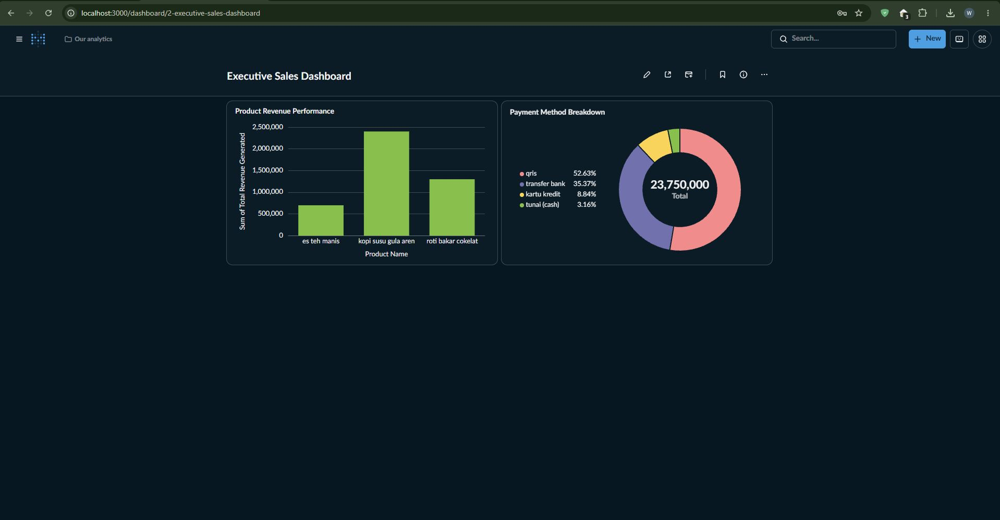

# PipeCraft: End-to-End Local Data Pipeline & Analytics Platform

**PipeCraft** is a complete, production-grade local Data Engineering pipeline. It extracts raw transactional data from an OLTP database (MySQL), loads it into a Data Warehouse (PostgreSQL), transforms raw schemas into clean analytical data marts using **dbt**, orchestrates workflow dependencies with **Prefect 3.x**, and serves executive insights via an interactive **Metabase** dashboard.

---

## 📸 Executive Dashboard Showcase

Below is the **Executive Sales Dashboard** built on Metabase, consuming directly from the dbt-modeled `analytics` schema in PostgreSQL (`bizpulse_dwh`).



---

## 🏗️ Architecture & Data Flow

```
[ MySQL (OLTP) ]
       │
       ▼  (Python Custom Ingestion - SQLAlchemy / Pandas / PyMySQL)
[ PostgreSQL (bizpulse_dwh - staging) ]
       │
       ▼  (dbt-core Transformations, Seeds, & Tests)
[ PostgreSQL (bizpulse_dwh - analytics schema) ]
       ├── fct_product_performance
       └── fct_payment_summary
       │
       ▼  (Metabase BI Dashboard)
[ Executive Sales Dashboard ]
```

**Orchestration Layer:** Entire sequence (`Ingest` ➔ `dbt seed` ➔ `dbt run` ➔ `dbt test`) is fully managed and scheduled via **Prefect 3.x** (`orchestrator.py`) with automatic retries and error logging.

---

## 🛠️ Tech Stack

* **Source Database (OLTP):** MySQL
* **Data Warehouse (OLAP):** PostgreSQL (`bizpulse_dwh`)
* **Data Ingestion:** Python 3.x (`pandas`, `sqlalchemy`, `pymysql`, `psycopg2`, `python-dotenv`)
* **Data Transformation & Modeling:** `dbt-core` v1.12+ (Postgres Adapter)
* **Workflow Orchestration:** `prefect` v3.8+
* **Business Intelligence:** Metabase Standalone (Java 21 JDK Runtime)

---

## 📊 Analytical Data Marts (dbt Models)

The transformation layer produces clean, aggregated data marts in the `analytics` schema:

1. **`analytics.fct_product_performance`**
   * **Purpose:** Measures total sales revenue and units sold per product category.
   * **Key Metrics:** `total_revenue_generated`, `total_units_sold`.
2. **`analytics.fct_payment_summary`**
   * **Purpose:** Breakdown of revenue distribution across payment channels.
   * **Key Metrics:** `grand_total_revenue`, segmented by `payment_method` (QRIS, Transfer Bank, Kartu Kredit, Cash).

---

## 🚀 How to Run Locally

### 1. Prerequisites
Ensure you have the following installed on your host OS:
* Python 3.10 or higher
* PostgreSQL & MySQL Server
* Java Runtime Environment (JDK 21 or higher for Metabase)

### 2. Environment Configuration
Clone the repository and copy `.env.example` to `.env`:
```powershell
copy .env.example .env
```
Fill in your database parameters in `.env`:
```env
MYSQL_HOST=localhost
MYSQL_PORT=3306
MYSQL_USER=root
MYSQL_PASSWORD=your_mysql_password
MYSQL_DB=bizpulse_db

POSTGRES_HOST=localhost
POSTGRES_PORT=5432
POSTGRES_USER=postgres
POSTGRES_PASSWORD=your_postgres_password
POSTGRES_DB=bizpulse_dwh
```

### 3. Install Python Dependencies
```powershell
python -m venv venv
.\venv\Scripts\Activate
pip install -r requirements.txt
```

### 4. Run Pipeline Options

#### Option A: Run End-to-End Pipeline via Prefect Orchestrator (Recommended)
Executes Ingestion ➔ dbt seed ➔ dbt run ➔ dbt test with interval-based scheduling:
```powershell
python orchestrator.py
```

#### Option B: Manual Step-by-Step Execution
1. **Ingest Raw Data:**
   ```powershell
   python main.py
   ```
2. **Run dbt Seeds, Models, & Tests:**
   ```powershell
   cd transform
   dbt seed
   dbt run
   dbt test
   ```

### 5. Launch Metabase BI Server
From the root directory:
```powershell
cd bi
java -jar metabase.jar
```
Open browser at `http://localhost:3000` to access or edit the **Executive Sales Dashboard**.

---

## 📂 Project Structure

```
Project1/
├── bi/
│   └── metabase.jar          # Metabase standalone runner (gitignored)
├── Image/
│   └── Dashboard.jpeg        # Metabase Executive Dashboard preview
├── transform/                # dbt project directory
│   ├── models/               # Staging & Analytics dbt models
│   ├── seeds/                # Seed CSV reference data
│   ├── dbt_project.yml       # dbt configurations
│   └── profiles.yml          # dbt connection profiles
├── .env.example              # Sample environment variables
├── .gitignore                # Excluded binary files & secrets
├── main.py                   # Ingestion script (MySQL -> Postgres)
├── orchestrator.py           # Prefect DAG & flow deployment
└── requirements.txt          # Python dependencies
```
